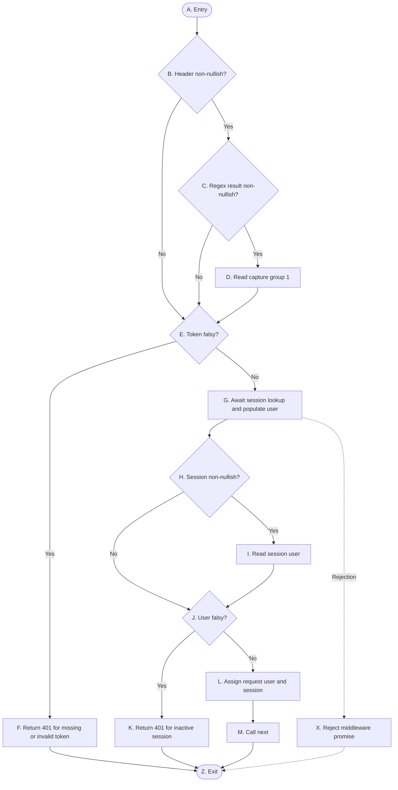

# EC4206 Section 3.4 — White-Box Testing

## 1. Function and scope

The selected function is [`authenticate(req, res, next)`, lines 10–18 of backend/middleware/auth.js](../../backend/middleware/auth.js#L10-L18). It protects account endpoints and other authenticated routes. It parses the bearer header, looks up an unexpired session by token hash, populates the session's user and either returns HTTP 401 or passes the request to the next handler. The separate `admin` function at lines 19–22 checks roles after authentication. Both roles exercise the same success path within `authenticate`.

| Source lines | Executable statements and decisions |
|---|---|
| 11 | Initialise `token`. The first optional chain checks whether the header is nullish before evaluating the regular expression. The second checks whether the match result is nullish before reading capture group 1. The expression accepts exactly the Bearer prefix followed by 64 lowercase hexadecimal characters. |
| 12 | Evaluate `!token`. When true, execute the early return and send HTTP 401 with `Please log in`. |
| 13 | Initialise `session` by awaiting a lookup on the token hash and expiry, with the user populated. The expiry comparison is strictly greater than the current time. |
| 14 | Evaluate `session?.user`, which skips the property read for a nullish session, and test its negation. When true, execute the early return and send HTTP 401 with `Session expired. Please log in again`. |
| 15–17 | Assign `req.user`, assign `req.session` and call `next()`. These are three separate executable statements. |

## 2. Control-flow graph and complexity

The solid edges show the ordinary completion paths. The dashed edges extend the graph with the controlled lookup rejection tested in WB-09. Both models use a single synthetic exit.



| Counting convention | Nodes N | Edges E | Connected components P | Calculation |
|---|---:|---:|---:|---|
| Ordinary flow, including optional-chain short circuits | 14 | 18 | 1 | V = E − N + 2P = 18 − 14 + 2 = **6** |
| Extended flow, with the lookup rejection | 15 | 20 | 1 | V = 20 − 15 + 2 = **7** |

The decision-point method gives **6** for ordinary flow, using two explicit guard decisions (E and J), three optional-chain decisions (B, C and H), and one base path. The extended graph adds one outcome at G for rejection, giving **7**. A count limited to explicit `if` statements gives **3** under the coarser convention of treating each optional chain as part of its surrounding expression. The report uses the expanded graph for the primary count.

The guards use unary negation and contain no `&&` or `||` operands. The two database filters in the object literal express a conjunction evaluated by MongoDB, so they do not add separate JavaScript decisions. The regex character class is likewise part of the match operation. Early returns connect to the common exit without adding decisions. Awaiting a successful lookup suspends and resumes execution on the same ordinary edge. The extended model adds a distinct rejected-promise path and treats downstream Express handling as outside the selected function. There is no local catch or finally block. This model covers the tested lookup failure without adding hypothetical exception edges for every expression or external callback.

Some graph edges are data-dependent. A missing header or failed match ensures a falsy token. A nullish session ensures a falsy user. The graph complexity is a structural measure, so its value does not prescribe the number of feasible independent business scenarios. Unknown, expired and revoked sessions share the no-match path. Different valid account roles share the success path.

## 3. Test path mapping and execution results

The tests call `GET /api/auth/me` and assert HTTP status and response data. WB-01 through WB-09 trace to **FR-02**, the existing authentication and session requirement. WB-08 verifies an administrator's authentication and identity. The administrator write-permission assertions remain in the black-box suite under FR-03. Fixture creation and revocation requests are setup actions outside the nine scenario counts.

| Test ID | Fixture or path condition | Graph path | Expected result | Actual result | Status |
|---|---|---|---|---|---|
| WB-01 | Omit Authorization header | A–B–E–F–Z | 401 and `Please log in` | 401 with the expected message | Pass |
| WB-02 | Send `Bearer short` | A–B–C–E–F–Z | 401 and `Please log in` | 401 with the expected message | Pass |
| WB-03 | Use a well-formed token without a matching session | A–B–C–D–E–G–H–J–K–Z | 401 and inactive-session message | 401 with the expected message | Pass |
| WB-04 | Date a synthetic student session's expiry in the past | A–B–C–D–E–G–H–J–K–Z | 401 and inactive-session message | 401 with the expected message | Pass |
| WB-05 | Log out a separate administrator session and reuse its token | A–B–C–D–E–G–H–J–K–Z | 401 and inactive-session message | 401 with the expected message | Pass |
| WB-06 | Use an unexpired synthetic session linked to a nonexistent user | A–B–C–D–E–G–H–I–J–K–Z | 401 and inactive-session message | 401 with the expected message | Pass |
| WB-07 | Use a current student session | A–B–C–D–E–G–H–I–J–L–M–Z | 200 with the correct identity and student role | 200 with the expected ID, email and role | Pass |
| WB-08 | Use a current administrator session | A–B–C–D–E–G–H–I–J–L–M–Z | 200 with the correct identity and admin role | 200 with the expected ID, email and role | Pass |
| WB-09 | Inject a rejected lookup through a scoped test mock | A–B–C–D–E–G–X–Z | One lookup and HTTP 500 with a generic error | One lookup and 500 with `Unable to complete request. Please try again.` | Pass |

For WB-03 through WB-06, the inactive-session message is `Session expired. Please log in again`. For WB-09, the isolated test process temporarily replaces the lookup and restores it afterward. Express handles the rejected middleware promise through its [error handler](../../backend/server.js#L19-L23).

## 4. Environment and coverage

The [white-box suite](../../backend/tests/white-box.test.js) ran on Windows using Node.js 25.6.0 and npm 11.8.0. Express bound to an ephemeral loopback port. The suite required a local MongoDB endpoint, selected and verified a random `campus_whitebox_test_` database and cleaned up tracked fixture records. Empty collections and indexes may remain. The full regression was also gated on a local MongoDB endpoint. Each backend suite selects its own random database.

To reproduce from the repository root, run the following coverage command. Choose an unused LCOV destination when preserving earlier evidence.

```powershell
node --test --experimental-test-coverage --test-coverage-include=backend/middleware/auth.js --test-reporter=tap --test-reporter-destination=stdout --test-reporter=lcov --test-reporter-destination=white-box-reproduction.lcov backend/tests/white-box.test.js
npm.cmd --prefix backend test
```

| Scope | Line coverage | Branch coverage | Function coverage |
|---|---|---|---|
| Entire `auth.js`, reported by Node | **82.61% (19/23)** | **100% (12/12 recorded ranges)** | **75% (3/4)** |
| `authenticate`, derived from LCOV entries | **100% (7/7 body lines 11–17)**. Declaration and closing lines 10 and 18 were also marked hit. | **9/9 recorded ranges starting within lines 10–18** | Invoked |

Node's V8 reporter supplies line, branch and function measurements. It supplies no independent statement percentage. The source-to-path review accounts for all nine source statements inside the body when the two guard statements and their two return statements are counted separately. WB-01 reaches the first return, WB-03 reaches the second return, and WB-07 reaches the assignments and `next()`. These results are a statement-path mapping supported by the tests, with the quantitative result reported as line coverage.

The only file lines reported uncovered were **19–22**, the separate `admin` function. V8 reported no branch range for that uninvoked function in this run. The 100% branch figure describes recorded coverage ranges and does not establish coverage of administrator role decisions or every runtime failure. The selected tests exercise normal completion and the controlled lookup rejection. They leave the exact expiration instant, real database outages and arbitrary downstream exceptions outside the execution.

Evidence for the focused run is preserved in [TAP](../evidence/EC4206_White_Box_Coverage.tap) and [LCOV](../evidence/EC4206_White_Box_Coverage.lcov).

## 5. Results and interpretation

| Evidence set | Passed | Failed | Skipped | Interpretation |
|---|---:|---:|---:|---|
| Historical Step 2 baseline | 26 | 0 | 0 | Original API, profile and password run, including parent tests. |
| Historical Section 3.3 black-box run | 27 | 0 | 0 | Individual scenarios. TAP counted 28 including the parent. |
| Section 3.4 focused coverage run | 9 | 0 | 0 | Individual scenarios. TAP counted 10 including the parent. |
| Section 3.4 full backend regression | 64 | 0 | 0 | Node total across the three original suites and both added suites, including parent tests. |

The focused and regression commands exited successfully. The [regression log](../evidence/EC4206_White_Box_Regression.txt) records the rerun totals. The [traceability matrix](../test-plans/EC4206_Test_Plan.md) retains the previous manual and black-box IDs. TC-001 passed by user confirmation. TC-005 has a partial login observation, and its formal status is Not Run. The other 34 manual cases remain Not Run. The current backend rerun includes the existing WB suite. TC-008 and TC-009 separately passed their catalogue assertions. [Automated catalogue results](EC4206_Automated_Execution_Results.md)
